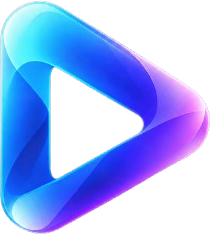

<p align="center">
  
</p>

<h1 align="center">NanoMOV</h1>

<p align="center">
  <strong>Ultra-Fast In-Browser MOV to MP4 Converter</strong><br>
  100% Client-Side · Zero Uploads · No File Size Limits · Instant Results
</p>

<p align="center">
  <a href="https://opensource.org/licenses/MIT"></a>
  <a href="https://developer.mozilla.org/en-US/docs/Web/JavaScript"></a>
  
  
</p>

---

## What is NanoMOV?

NanoMOV is a free, open-source, fully offline web tool that runs entirely in your browser. No servers. No uploads. No accounts. Everything happens on your device.

| Tool | What it does |
|---|---|
| **NanoMOV Converter** | Converts `.mov` (QuickTime) to `.mp4` in milliseconds via zero-copy stream remuxing — no re-encoding, no quality loss |
| **Analog Camera Studio** | Strips AI-generation fingerprints from images and re-applies authentic 35mm film grain and real camera EXIF metadata |

---

## Why is NanoMOV Fast?

Traditional converters upload your video to a server, re-encode every frame, and put you in a queue.

NanoMOV uses **Stream Copy Remuxing**:

- `.mov` and `.mp4` share the same underlying H.264/AAC bitstream
- NanoMOV rewrites only the container header — no decoding, no re-encoding
- Adds **Web FastStart** (`+faststart`) by moving `moov` atom before `mdat`
- Recalculates all chunk offsets (`stco` / `co64`) for byte-perfect output
- Multi-gigabyte support via `Blob.slice()` — never loads the full file into RAM

### Performance Comparison

| Method | 1 GB File | Quality Loss |
|---|---|---|
| Online converter (cloud re-encode) | 10 to 30 minutes | Lossy |
| FFmpeg local (`-c copy`) | 3 to 5 seconds | None |
| **NanoMOV (browser)** | **Under 1 second** | **None (bit-perfect)** |

---

## Features

### MOV to MP4 Converter

- Millisecond conversion — pure JavaScript zero-copy stream remuxer
- 100% private — your file never leaves your browser
- No file size limit — handles multi-GB recordings via chunk streaming
- Web FastStart — `moov` relocated before `mdat` for instant web playback
- In-browser preview — play and verify your converted MP4 before downloading
- Zero quality loss — bit-perfect video and audio frames preserved

### Analog Camera Studio

- Strips AI-generation metadata fingerprints from images
- Applies authentic 35mm film grain to break diffusion lattice patterns
- Adds real optical vignetting (simulates camera lens falloff)
- Injects authentic Apple iPhone 15 Pro EXIF metadata
- Runs 96% resize cycles to disrupt AI upscaling artifacts
- Works entirely offline — no API keys required

---

## Usage

### Open Directly (No Install Required)

```bash
git clone https://github.com/Akshay-gurav-31/NanoMOV.git
cd NanoMOV

# Windows
start index.html

# macOS
open index.html

# Linux
xdg-open index.html
```

### Serve Locally

```bash
python -m http.server 8080
# Then open: http://localhost:8080
```

---

## How It Works

### MOV to MP4 Remuxer (Pure JavaScript)

Parses the ISO Base Media File Format (ISOBMFF) binary structure:

```
ftyp  -> Rewritten: qt -> isom/mp42
moov  -> Moved BEFORE mdat (+faststart)
  |__ stco/co64 -> Chunk offsets recalculated
mdat  -> Untouched (zero-copy passthrough)
```

### Analog Camera Studio Pipeline

```
Input -> Strip Metadata -> 96% Resize Cycle -> Film Grain
      -> Optical Vignette -> EXIF Injection -> Output
```

---

## Running Tests

Requires Python 3 and FFmpeg installed:

```bash
python tests/test_mov_converter.py    # MOV to MP4 remuxer + faststart + codecs
python tests/test_metadata_audit.py   # EXIF and metadata pipeline
python tests/test_isobmff_remux.py    # ISOBMFF box parsing
python tests/test_streaming_remux.py  # Large file chunk streaming
```

---

## Tech Stack

| Layer | Technology |
|---|---|
| Structure | Semantic HTML5 |
| Styling | Vanilla CSS |
| Video Remuxer | Pure JavaScript (DataView / Uint8Array binary parser) |
| Image Processing | HTML5 Canvas API |
| EXIF Writing | Custom binary EXIF encoder |
| Runtime Dependencies | Zero |

---

## Browser Support

Chrome 90+, Edge 90+, Firefox 88+, Safari 15+

---

## Contributing

Pull requests are welcome.

1. Fork the repository
2. Create a feature branch
3. Commit your changes
4. Open a pull request

---

## License

MIT License — free to use, modify, and distribute.

---

## Privacy

NanoMOV processes everything locally in your browser.

- No file uploads
- No analytics or tracking
- No cookies or sessions
- Your files never leave your device
